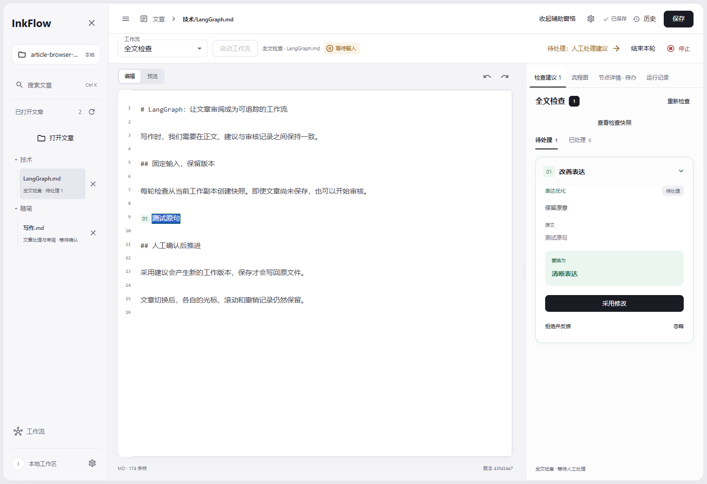

# InkFlow

InkFlow 是一个使用 LangGraph 的中文本地文章工作台。打开已有 Markdown／MDX，编辑全文、检查并逐条处理建议、恢复历史版本，最后保存到原文件。

文章与编辑历史保存在本机。编辑器始终是主界面，无需启动工作流；可按需选择内置工作流，在同一工作台查看流程、处理人工审核和输出文章，CLI 保留。



截图使用模型替身和隔离的示例目录。

## 在 Windows 启动

使用现有的 `openai_agents` Conda 环境、Python 3.11+，以及 Node.js 22.12+ / npm。所有 Python 命令都先激活该环境；不要在其它 Python 环境中运行项目。

在项目根目录打开 PowerShell：

```powershell
conda activate openai_agents
python -m pip install -e .

# 已有 llm.toml 时保留原文件；首次使用也可以直接在页面设置模型。
if (!(Test-Path llm.toml)) { Copy-Item llm.example.toml llm.toml }

cd frontend
npm ci
npm run build
cd ..

$env:PYTHONPATH = "src"
python -m inkflow.web
```

打开终端打印的 **InkFlow 访问地址**。默认先尝试 `http://127.0.0.1:18765`；端口被占用或系统拒绝绑定时，自动改用系统分配的可用端口。正式使用只需后端进程，后端会提供 `frontend/dist` 中已构建的页面。源码安装时保留 `frontend` 目录；前端资源目前不打包进独立 Python wheel。

之后启动：

```powershell
conda activate openai_agents
$env:PYTHONPATH = "src"
python -m inkflow.web
```

自定义配置并直接让系统分配可用端口：

```powershell
conda activate openai_agents
$env:PYTHONPATH = "src"
python -m inkflow.web --config config.toml --port 0
```

如需固定端口，可使用 `--port 18765`。显式指定非零端口后，该端口不可用时会报错并提示 `--port 0`，不会自动更换端口。

如果依赖或 Conda 环境缺失，请先确认安装位置和依赖需求，再自行安装；不要改用系统 Python。工作台只监听 `127.0.0.1`，使用单个服务进程。

## 编辑本地文章

首页为文章编辑工作台。默认工作区是配置文件所在目录；也可在启动时明确授权其它文章目录：

```powershell
conda activate openai_agents
$env:PYTHONPATH = "src"
python -m inkflow.web --workspace E:/path/to/articles
```

1. 点击“打开文章”搜索工作区 UTF-8 Markdown／MDX，已打开文章按真实目录显示，重复打开选中已有条目。使用 CodeMirror 编辑工作副本，或切到 Markdown 预览。
2. 在顶部选择“全文检查”启动，或使用“重新检查”快捷入口。正式运行固定当前未保存稿件快照，返回局部和全文结构建议后等待人工处理；可采用、忽略、拒绝反馈，点击“结束本轮”释放本篇文章名额。重新检查创建新轮次并保留旧记录。
3. 手改会更新定位，触及原文或存在定位歧义时建议失效。结构建议通过手动修改处理。修改后可重新检查全文。
4. “历史”查看持久化快照并恢复到编辑区，“保存”才写回原文件。编辑器撤销栈、文章版本与 Agent checkpoint 相互独立。

修改约 650ms 后自动持久化本地草稿；文章切换时保留各自光标、选择、滚动、预览与撤销/重做。刷新恢复已打开文章、当前文章、持久化草稿和真实运行状态，撤销栈不跨刷新；尚未持久化时离页有提醒。关闭文章视图不停止运行、不丢弃草稿。保存检测到外部修改时拒绝覆盖，可在错误提示中选择“读取磁盘版本”核对，替换前的草稿保留在历史中。

文章编辑上限为 2 MB；全文检查上限为 24,000 Unicode 字符，不会静默截断。历史面板显示最近 200 个版本，数据库保留全部记录。MDX 不执行 JavaScript；预览仅支持 Markdown，不加载本地相对资源。原文中的 frontmatter、MDX、代码块、BOM 和既有换行保持保存，新增换行使用 LF。

SQLite 保存文章草稿、版本快照、正式运行与审核记录。未经手动保存，版本恢复不会改写原文件。文件导航和辅助窗格都可收起，释放空间供编辑；辅助窗格支持拖动分隔条或聚焦后用方向键调整大小。宽屏并排展示，窄屏移到正文下方。

辅助窗格提供“检查建议”“流程图”“节点详情”“运行记录”。展开、收起或切换辅助内容会保留当前正文、预览状态、光标和撤销栈；顶部继续显示运行状态与待办。设置可从顶部齿轮进入，文件导航收起后也可访问。

## 完成一次文章处理任务

1. 打开文章后在顶部选择“文章处理与审阅”，点击“启动工作流”，确认基于当前工作副本创建运行，可禁用本次博客写入。输入固定为这篇文章的文本与版本快照；新 Web 运行必须绑定文章，独立文件输入继续使用 CLI。
2. 在“人工审核”逐项选择采用建议、忽略或自定义修改。未启用模型时没有自动风险分析，需要自行检查输入。
3. 对候选脱敏稿检查 diff；接受后直接成为主编辑器的新工作副本并复查，替换前版本可回看和恢复，原文件不自动写入。确认前有新编辑时拒绝覆盖，可重新对比并明确确认替换，或要求重新改写。
4. 模型生成文章，信息不足时最多追问三次。关闭模型或生成失败时明确显示“降级占位结果”，不能视为正式稿。
5. 其它文章生成稿仍需点击顶部“对比并载入编辑区”，核对差异并确认。主编辑区已有新修改时，需勾选替换确认；旧稿保留在文章历史，原文件需点击“保存”才写回。可在主编辑区继续修改，再点击“提交编辑稿到工作流”生成新的审阅版本；输出前会核对稿件是否已提交。节点详情中的文章属性编辑仍可调整标题、slug、描述、日期、标签、作者及草稿标记。
6. 在节点详情选择“保存审阅稿并结束”，或核对目标路径后“确认写入博客”。目标已存在时必须勾选覆盖确认。
7. 在“节点详情”查看各轮输入输出与可下载的审阅稿、流程报告、JSONL 审计记录；在“运行记录”选择历史运行并查看当前运行时间线。

流程图与节点详情位于编辑器旁的同一辅助窗格。点击节点进入详情，收起后可从顶部待办按钮继续处理。窄屏默认节点列表，也可切回流程图；流程图支持缩放、平移、定位当前节点和键盘选择，已执行连线高亮，循环保留次数。

退回生成或脱敏会使旧确认失效。停止请求在节点边界生效，进行中的模型请求允许完成或超时；已写入的文件保留。

右侧默认展示当前文章的历史与时间线；历史运行及检查快照只读查看，不能直接改写当前稿件。旧无文章关联记录从“查看旧版未关联历史”进入，不猜测归属。左侧所有文章持续更新运行状态。

向工作流提交生成稿时，顶部元数据保留其双引号字符串、方括号数组与 true/false 格式；新增或不支持的元数据会明确报错，普通文章保存仍完整保留原文。

当前注册 `full-check`（全文检查）与 `reviewed-publishing`（文章处理与审阅）。工作流列表由后端提供，创建运行时按标识调用真实执行工厂；每个运行保存所属工作流和实际图结构快照，历史图与节点状态始终对应自身运行。旧客户端省略标识仍运行默认流程，旧历史自动归入内置流程。

本轮不实现文件监听、定时同步或自动更新。未来来源变化可提供新文本快照，由显式触发创建对应工作流运行；候选修订经过人工审核后，经编辑器 revision 与磁盘指纹校验保存为新版本，不直接覆盖当前草稿。详见本地 [工作台与工作流文档](docs/workbench-and-workflows.md)。

## 设置与密钥

页面“设置”可编辑：

| 设置 | 行为 |
| --- | --- |
| 模型参数 | `llm.toml` 中的模型名、OpenAI-compatible 服务地址、随机性、超时、token 上限和启用状态 |
| 博客仓库 | `config.toml` 的 `blog.repo_path`，应为已存在的本机目录；可留空并仅保存审阅稿 |
| 博客内容目录 | `blog.content_dir`，仓库内相对路径，默认 `src/content/blog` |
| 审阅稿与报告 | `review.dir` / `report.dir`，相对路径基于配置文件目录 |
| API Key | 单独保存到配置文件目录下 `.inkflow/secrets.json`；只返回配置状态，不回显密钥 |

保存使用 TOMLKit，保留配置注释和无关字段。每个任务启动时固定配置及密钥，后续设置修改只影响新任务。本地密钥优先；清除后使用 `api_key_env` 指向的环境变量。密钥文件是本机明文私有文件，不是系统密钥库；POSIX 下使用 `0600`，Windows 下在写入密钥前显式设置仅当前用户可访问的 DACL，关闭宽泛权限继承，设置失败则不写入。

路径按**实际后端操作系统**解析。Windows 后端可使用 `E:/code/blog`；WSL 后端应使用 `/mnt/e/code/blog`。不会把 Windows 盘符在 WSL 下当作相对目录创建。

模型关闭时仍可手动编辑、预览、保存与恢复版本；全文检查会明确提示需要模型配置。原有任务仍可使用离线占位流程。启用模型前请检查已有 `llm.toml`。

## 历史、产物与本地数据

- SQLite：`<配置文件目录>/.inkflow/history.sqlite3`，保存输入、工作流标识与流程结构快照、非敏感配置快照、节点执行、已保存编辑、操作幂等记录及递增事件。
- 归档：`.inkflow/artifacts/<任务 ID>/`。下载只读取本任务登记的归档副本，浏览器不能指定任意本机路径。后续任务覆盖博客文件不会改变旧任务的归档。
- 审阅稿：`<review.dir>/<任务 ID>.md`。同一任务保存编辑时更新这份文件；各轮内容仍可在节点历史及审计中查看。
- 报告：`<report.dir>/<任务 ID>.md` 与 `.jsonl`，包含脱敏方案、审核、追问、文章版本、降级提示和输出路径。

应用数据目录在 POSIX 下限制为 `0700`，数据库及 WAL、SHM、journal 限制为 `0600`，启动时也收紧旧文件权限；Windows 数据目录使用仅当前用户的可继承 DACL。目录需位于支持对应权限的文件系统中。运行详情、事件和产物按当前工作区校验归属；切换后旧工作区的请求会被拒绝，旧 SSE 连接停止发送，切回后可再次查看。旧无文章关联历史继续提供只读查看。

刷新页面会重新获取状态并连接 SSE；事件支持 `Last-Event-ID` 和 `after` 补发。页面时间线展示最近 200 条事件，完整事件保存在 SQLite；节点执行记录保留全部轮次。

LangGraph 使用**进程内检查点**。服务重启后，未完成任务标记为“已中断”，不能继续原等待步骤；重新运行基于当前文章工作副本创建新实例并保留旧记录。同一篇文章最多一个活跃运行（包含等待人工和停止中），后端锁和 SQLite 唯一键防止并发绕过；不同文章可分别启动，最多四个执行线程，等待人工不占用线程。

重复请求 ID 不会重复推进；已经失效的审核 ID 返回冲突提示。文件写入失败会显示失败并保留已有记录，不会显示为成功。

## 博客写入与安全边界

确认后，仅写入：

```text
<blog.repo_path>/<blog.content_dir>/<slug>/index.mdx
```

不会执行构建、`git add`、`git commit`、`git push`，不会生成或删除 `banner.png`、`img/` 等资源。slug 使用小写英文、数字及连字符，并检查目录越界与符号链接；写入使用同目录临时文件原子替换。普通 POSIX 文章保留已有文件权限，新文件按 `0666` 与当前 umask 创建，以便构建或部署账户按目录策略读取。

覆盖前显示目标与是否存在，并核对现有文件指纹；如果人工等待期间目标变更，会拒绝写入。成功覆盖不自动备份或回滚原博客文件，请按需使用博客仓库自己的版本管理。此检查适用于本地单用户流程，不提供对其它进程恶意竞争修改目录的防御保证。

原文、审阅稿、历史数据库和报告可能含敏感信息；它们只保存在本机，但不应公开提交。默认 `.inkflow/`、`reviews/`、`reports/`、`llm.toml` 已被 Git 忽略；如果改为其它输出目录，请自行维护忽略规则。

启用模型后，待处理内容会发送给配置的模型服务。API Key 不进入工作流状态、历史数据库或报告。浏览器预览不执行 HTML / MDX 脚本，外部图片显示为文本说明；生成的 `.mdx` 内容仍需人工审阅后交给博客构建系统。应用不执行文章中的命令。

## 命令行兼容

```powershell
conda activate openai_agents
$env:PYTHONPATH = "src"
python -m inkflow.main --input note.md
python -m inkflow.main --workflow reviewed-publishing --input note.md --no-publish
python -m inkflow.main --workflow full-check --input note.md
python -m inkflow.main --config config.toml
```

`--workflow` 默认是 `reviewed-publishing`，可选值来自与 Web 相同的注册表，未知标识会被拒绝。没有 `--input` 时读取 `config.toml` 的 `input_path`。不要直接执行 `src/inkflow/main.py`。

- 全文检查：终端查看本轮建议后，回车结束本轮或 `s` 停止；逐条采用建议在 Web 中完成。
- 脱敏审核：回车采用建议，`n` 忽略，输入文字自定义，`s` 停止；逐项处理后 `y` 继续。
- diff：`y` 接受，`n` 重试，文字补充建议，`s` 停止。完整 diff 保存在 `<report.dir>/<任务 ID>-diff-preview.diff`。
- 追问：输入回答；`/stop` 停止。
- 最终审阅：`y` 接受并写入博客，`f` 只保存，`g` 退回生成，`d` 退回脱敏，`s` 停止；其它文字作为生成建议。覆盖现有文件还需输入 `overwrite`。
- `--no-publish` 时，`y` 也只保存审阅稿和报告；执行失败退出码为 1。

CLI 与 Web 共用图与业务逻辑。CLI 产物写入配置目录，但 CLI 运行本身不进入 Web 的 SQLite 历史。CLI 终端显示摘要和本地路径，不直接输出长篇正文。

## 前端开发与验证

开发时后端显式指定端口，便于 Vite 代理连接：

```powershell
conda activate openai_agents
$env:PYTHONPATH = "src"
python -m inkflow.web --port 18765
```

另开前端终端：

```powershell
cd frontend
npm ci
npm run dev
```

打开 Vite 输出的本机地址，`/api` 默认通过同源代理访问 `127.0.0.1:18765`。若后端使用其它端口，在启动 Vite 的终端指定后端打印的地址（下面的 54321 仅为示例）：

```powershell
$env:INKFLOW_BACKEND_URL = "http://127.0.0.1:54321"
npm run dev
```

不要把后端或 Vite 绑定到公网地址。

```powershell
cd frontend
npm run typecheck
npm run build
```

项目不新增测试文件。此次实现用临时脚本在隔离目录验证工作流分支、输出一致性、SSE、幂等、目录边界、设置、重启和 CLI；浏览器验证桌面与手机操作。真实模型服务的质量与连通性需要使用自己的配置确认。

## 实现地图与学习路径

```text
frontend/src/                   常驻文章编辑、可调整辅助窗格、流程图、审核与设置
src/inkflow/workflows/          工作流定义与内置注册表，Web / CLI 共用入口
src/inkflow/runtime.py          运行时配置、进程内密钥和停止信号
src/inkflow/web/app.py           FastAPI、SSE、同源边界与静态页面
src/inkflow/web/runs.py          按文章运行管理、操作幂等与产物归档
src/inkflow/web/storage.py       SQLite 历史与事件
src/inkflow/settings.py          TOML 设置、路径校验与独立密钥文件
src/inkflow/graphs/minimal.py    LangGraph 节点、interrupt、路由和自定义事件
src/inkflow/actions.py           Web / CLI 共用人工操作校验
src/inkflow/services/terminal.py 终端适配器
src/inkflow/services/            模型业务、拼装、原子写入、报告
src/inkflow/state/workflow.py    可持久化业务状态（不含密钥）
```

建议按“单次模型调用 → 独立人工等待 → `Command(resume=...)` → 自定义事件 → 业务历史”顺序学习。详见 [学习计划](plan.md) 与根目录 `implementation-notes.md`（本地实施记录，沿用 Git 忽略规则）。

图采用现有依赖范围支持的 `stream_mode=["updates", "custom"]`；中断恢复会重入等待节点，因此模型和写入分开实现。[LangGraph 中断文档](https://docs.langchain.com/oss/python/langgraph/interrupts)、[Streaming 文档](https://docs.langchain.com/oss/python/langgraph/streaming)。前端节点样式基于 [React Flow 自定义节点](https://reactflow.dev/learn/customization/custom-nodes)。
