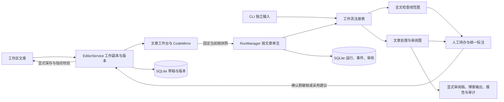

# 系统概览

InkFlow 是本机文章编辑工作台和 CLI。React / TypeScript / Vite / MUI 提供统一文章视图，CodeMirror 保存源码编辑会话，FastAPI 提供同源 API，LangGraph 执行注册工作流，SQLite 保存工作副本、版本与运行事实。

- 文章身份包含工作区与规范化相对路径。左侧已打开文章、正文、建议、当前运行、流程图和历史属于同一文章上下文。
- EditorService 管文件边界、原文保留、revision、历史、磁盘指纹与原子保存。磁盘原文、工作副本、固定检查快照、候选稿、已确认版本分别存在。
- RunManager 统一管理两类工作流生命周期、幂等、pending_id、事件、标注审核和产物；SQLite article_active 保证文章唯一活跃名额。不同文章可以并发，线程池受控。
- Runtime 只在进程内持有模型密钥和停止信号。LangGraph 检查点不当作文档版本，也不跨重启恢复；服务重启将活跃运行标记中断。
- 脱敏接受候选先校验工作副本基线并创建版本，再基于已确认稿复查。其它文章生成分支、人工追问、最终审阅和显式博客输出继续保留。
- Web 只监听本机并限制同源请求；预览不执行 MDX/HTML，不自动加载外部图片。CLI 仍复用相同注册图与人工中断适配。

业务与接口见[统一工作台](../workbench-and-workflows.md)，实现分工见[编辑器](04-editor-workbench.md)、[运行与持久化](03-web-runs-and-storage.md)、[前端组件](05-frontend-map.md)与[配置边界](06-configuration-and-boundaries.md)。
