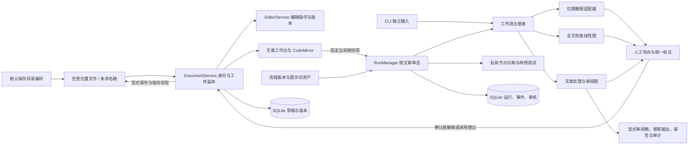

# 系统概览

InkFlow 是本机文章编辑工作台和 CLI。React / TypeScript / Vite / MUI 提供统一文章视图，CodeMirror 保存源码编辑会话，FastAPI 提供同源 API，LangGraph 执行注册工作流，SQLite 保存工作副本、版本与运行事实。

- document_id 通过规范化文件位置复用。侧栏按真实路径保留打开历史，默认保存目录只是首次保存的位置偏好；正文、建议、运行和历史按文档绑定，页面切换或修改默认目录不改变目标。旧工作区服务继续供来源采集与兼容客户端使用。
- EditorService 管文件边界、原文保留、revision、历史、磁盘指纹与原子保存。磁盘原文、工作副本、固定检查快照、候选稿、已确认版本分别存在。
- RunManager 统一管理三类工作流生命周期、幂等、pending_id、事件、标注审核和产物；SQLite article_active 保证文章唯一活跃名额。不同文章可以并发，线程池受控。
- Runtime 固定版本包，统一消息渲染、模型调用与诊断；密钥只在内存中，停止请求持久化。正式 LangGraph 检查点不当作文档版本，按 P4 协议跨重启恢复；未知外部效果先核验。
- 脱敏接受候选先校验工作副本基线并创建版本，再基于已确认稿复查。其它文章生成分支、人工追问、最终审阅和显式博客输出继续保留。
- Web 只监听本机并限制同源请求；预览不执行 MDX/HTML，不自动加载外部图片。CLI 仍复用相同注册图与人工中断适配。

业务与接口见[统一工作台](../workbench-and-workflows.md)，实现分工见[编辑器](04-editor-workbench.md)、[运行与持久化](03-web-runs-and-storage.md)、[前端组件](05-frontend-map.md)与[配置边界](06-configuration-and-boundaries.md)。

P5 的 `automation/` 负责有界来源检查、变化证据和持久积压，使用固定请求身份创建 RunManager 运行；自动化中心与文章页共享待办。来源不变不运行，候选确认与文件输出继续走原版本保护。见 [持续关注](../automations.md)。

## AI 编排与修复

P6 在现有资产、诊断与执行服务上增加 ai/ 提案层；生成不执行流程，明确采用及验证后交回资产服务启用。业务边界见 [AI 编排与修复](../ai-orchestration.md)。
