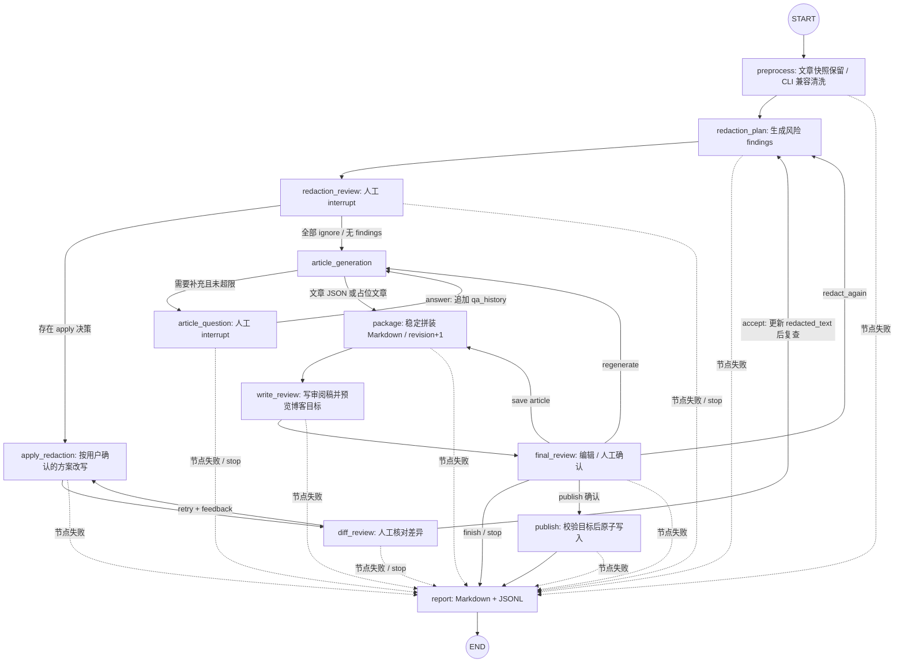
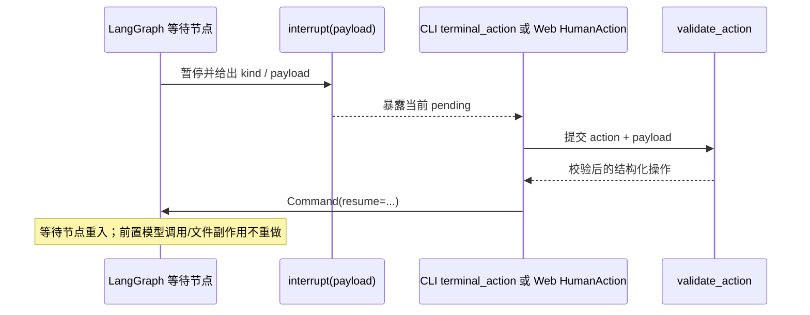

# 2. 内容处理工作流

## 2.1 LangGraph 实际节点图

虚线的人工交互（不表示业务边）：

## 2.2 逐阶段解释

### A. 输入与预处理

- CLI 用 `--input` 优先于配置的 `input_path`，按 UTF-8 读文件；Web 新任务由用户上传/粘贴文本。初始状态主要有 `raw_text`、`source_path`、`config` 和 `warnings`。见 [CLI 输入](../../src/inkflow/main.py#L82-L104)、[初始状态](../../src/inkflow/main.py#L121-L145)。
- 绑定文章的 `preprocess` 完整保留原文；CLI 保留去首尾空白、替换小写 `password` 与中文“密码”的旧示例清洗。检测保存实际 checked_text，避免把处理后坐标套到原文；这些预处理不代表完整 DLP 保证。之后生成业务 `run_id`，设置处理状态。见 [预处理节点](../../src/inkflow/graphs/minimal.py#L115-L119)。

### B. 脱敏方案、人工决策与复核

- `redaction_plan` 将当前 `_source` 加行号交给脱敏服务，得到 `RedactionFinding[]`；模型未启用时 findings 是空列表。模型请求失败或返回 JSON 无效会转成高风险提示，不静默当作已通过。见 [脱敏服务](../../src/inkflow/services/redaction.py#L35-L73)、[失败 finding](../../src/inkflow/services/redaction.py#L208-L235)。
- `redaction_review` 是 interrupt 等待点。即使无 finding 仍等待用户继续/停止；UI 提示模型未启用时应人工检查。用户每个 finding 可 apply、ignore 或自定义。公共校验器检查每项是否齐全、finding ID 不重复和输入长度。见 [人工审查节点](../../src/inkflow/graphs/minimal.py#L121-L129)、[操作校验](../../src/inkflow/actions.py#L45-L80)。
- 只有存在 apply 的 decision 才走 `apply_redaction`；服务仅依据已确认决定调用 LLM。结果进入 `diff_review`；用户接受后更新 `redacted_text` 并重新运行 `redaction_plan`，重试则带 feedback 重做当前改写。stop 进入 report。见 [改写与路由](../../src/inkflow/graphs/minimal.py#L131-L138)、[服务边界](../../src/inkflow/services/redaction.py#L76-L102)。

### C. 文章生成与显式版本

- `article_generation` 每次只调用一次模型。模型可返回结构化文章或追问；追问上限 3 次，`article_question` 收答复并追加 `qa_history` 后回到 generation。见 [文章生成服务](../../src/inkflow/services/article.py#L28-L63)、[状态回路](../../src/inkflow/graphs/minimal.py#L140-L148)。
- LLM 未启用或文章生成异常时会生成占位文章并设置 `degraded`/warning；代码仍允许人工在 final review 检查并选择发布，不能把 degraded 当作系统强制阻断。见 [生成节点](../../src/inkflow/graphs/minimal.py#L273-L286)。
- `ArticleData` 约束 title、slug、description、date、tags、authors、draft、body 等字段；包装服务确定性生成 frontmatter 和 Markdown，不让模型自由拼装文件头。见 [状态类型](../../src/inkflow/state/workflow.py#L44-L60)、[Markdown 拼装](../../src/inkflow/services/packaging.py#L12-L49)。
- `package` 每次建立新的 `final_document`、增加 `revision` 并重置 `approved=False`；保存审阅稿后，在 final_review 选择 save 会回到 package 再生成新版本，而不是静默覆盖旧确认。见 [package/write_review](../../src/inkflow/graphs/minimal.py#L150-L179)。

### D. 最终确认、发布和审计

- final review 可保存审阅稿并结束、编辑并保存新版本、退回生成、退回脱敏或确认写博客。退回上游会清除旧文档和批准状态，避免旧 revision 被发布。见 [最终审阅状态变化](../../src/inkflow/graphs/minimal.py#L181-L200)。
- 博客写入必须有 `approved`，目标是仓库内 `<safe-slug>/index.mdx`；写前需核对 preview 的路径/存在状态/fingerprint，原子替换。不会执行博客构建、Git add/commit/push，也不回滚已写出的文件。见 [发布节点](../../src/inkflow/graphs/minimal.py#L202-L209)、[目标保护](../../src/inkflow/services/publish.py#L19-L63)。
- 正常结束、stop 和可恢复的节点失败会走 report；报告先 Markdown 后 JSONL，第二次写入失败时前一个 Markdown 文件可能已存在。报告与 JSONL 可含原文、findings 和模型输出，应按敏感本地数据处理。见 [report 节点](../../src/inkflow/graphs/minimal.py#L211-L220)、[报告内容](../../src/inkflow/services/report.py#L25-L35)、[报告正文字段](../../src/inkflow/services/report.py#L55-L84)。

## 2.3 状态演化速览

| 阶段 | 主要新增/变更字段 | 后续消费方 |
| --- | --- | --- |
| 输入 | `raw_text`, `source_path`, `config`, `warnings` | preprocess / report |
| 预处理 | `clean_text`, `run_id`, `review_status`, `approved` | redaction plan |
| 脱敏 | `redaction_findings`, `redaction_decisions`, `candidate_text`, `redacted_text`, `redaction_diff` | 人工节点 / 文章生成 |
| 文章 | `question`, `qa_history`, `article_data`, `degraded` | package / report |
| 审阅版本 | `final_document`, `revision`, `review_path`, `publish_preview` | final review / publish |
| 收尾 | `approved`, `review_status`, `blog_path`, `report_path`, `report_jsonl_path`, `failure`, `stopped` | Web / CLI 输出 |

完整类型见 [InkFlowState 与相关 TypedDict](../../src/inkflow/state/workflow.py#L14-L124)。`audit_events` 由 node wrapper 按节点增量追加，密钥通过 `WorkflowRuntime.scrub()` 递归剔除；见 [runtime 与审计包装](../../src/inkflow/graphs/minimal.py#L81-L97)、[节点 wrapper](../../src/inkflow/graphs/minimal.py#L223-L253)。

## 2.4 修改影响面

- 增加/删除节点必须同步 `functions`、`ROUTES`、`NODE_META`、`INPUT_FIELDS` 与前端 `Workflow`/pending 展示；重点入口在 [图定义](../../src/inkflow/graphs/minimal.py#L35-L79)、[图编译](../../src/inkflow/graphs/minimal.py#L288-L310)。
- 新人工动作应同时更新 [validate_action](../../src/inkflow/actions.py#L45-L100)、CLI adapter 和 Web UI action payload；需保留 revision/pending ID 校验。
- 增加状态字段要查看持久化 payload、事件序列化、报告与 UI 类型。密钥不能加入 `InkFlowState`。
- 改文章输出 schema 时交叉核对生成器、Pydantic/TypedDict 校验、打包服务、CLI 与前端 final_review 表单。

## 2.5 证据与限制

- **代码确认**：节点图、分支、state update、错误包装、模型降级、写入路径和 interrupt 恢复均由图与调用服务源码支持。
- **结构推断**：人工确认是主要流程闸门，但模型 findings、diff 与 prompt 不能替代可靠安全检测；代码依赖人工复核风险。
- **尚未确认**：具体模型是否遵循只改确认片段、生成文章质量以及真实博客构建兼容性需按配置目标另行测试。
