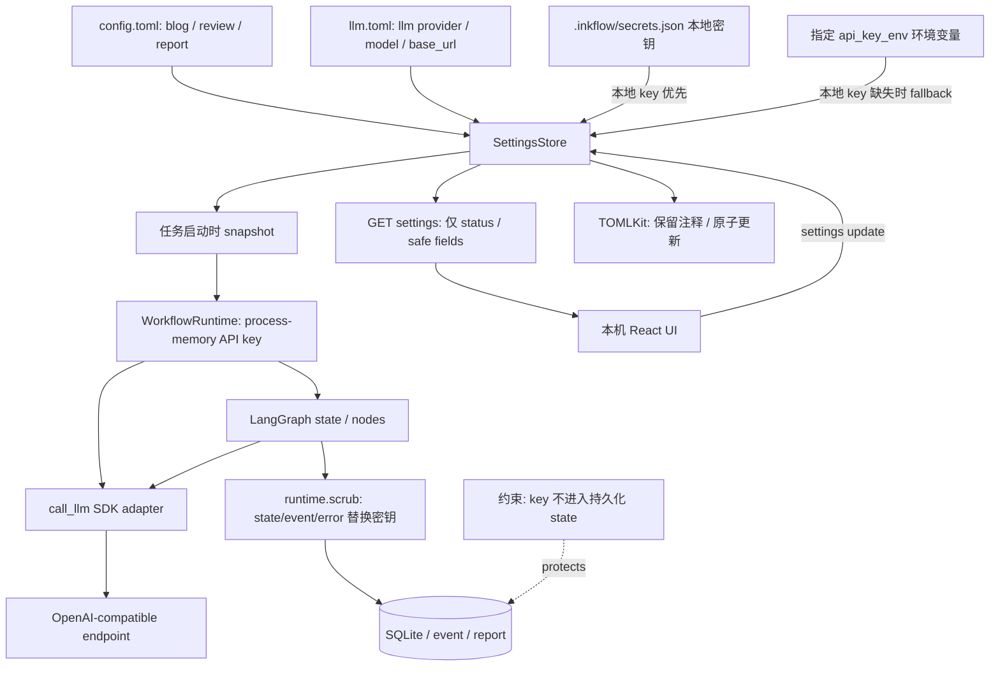

# 6. 配置、密钥与副作用边界

## 6.1 配置 / 密钥流

## 6.2 配置和密钥管理

- `config.toml` 保存博客仓库、相对内容目录、review/report 目录；`llm.toml` 保存 `enabled/provider/model/base_url/api_key_env/temperature/timeout/max_tokens`。`SettingsStore` 用 TOMLKit 只改已知段，保留无关配置与注释；详情见 [配置模型](../../src/inkflow/settings.py#L24-L84)、[读取与保存](../../src/inkflow/settings.py#L114-L198)。
- provider 当前固定为 `openai-compatible`。`base_url` 必须为 HTTP(S)，不能嵌入用户名/密码/query/fragment；密钥单独保存在 `<data-dir>/secrets.json`，本地 key 优先于环境变量。见 [模型配置校验](../../src/inkflow/settings.py#L42-L65)、[key 读写](../../src/inkflow/settings.py#L139-L162)。
- 前端设置接口只回传“是否已配置/是否本地保存”，API schema 用 `SecretStr`，UI 输入是 password 字段。Key 文件是本机明文私有文件，不是系统密钥库；POSIX 权限 0600，Windows 用进程用户 SID 显式设置受保护 DACL，仅授权当前用户，临时文件在写入正文前设权，失败则终止并清理。读取旧密钥时也收紧权限。数据目录 POSIX 0700，Windows 使用仅当前用户的可继承 ACE；不改变配置目录和祖先权限。见 [文件权限](../../src/inkflow/services/file_permissions.py)、[原子写入](../../src/inkflow/services/local_files.py)、[密钥读写](../../src/inkflow/settings.py)。Windows API 语义参考 [SetNamedSecurityInfoW](https://learn.microsoft.com/en-us/windows/win32/api/aclapi/nf-aclapi-setnamedsecurityinfow)。
- 创建 Run 时取一次 settings snapshot；key 作为 runtime 依赖，不进入可持久化 `InkFlowState`。节点输出、interrupt payload 与错误摘要使用递归 scrub。见 [snapshot](../../src/inkflow/settings.py#L200-L213)、[WorkflowRuntime](../../src/inkflow/graphs/minimal.py#L81-L97)。这不代表原始文章本身不含敏感内容。

## 6.3 文件路径和发布目标

- 编辑器 workspace 默认是配置目录，或由 `--workspace` 显式授权；界面可通过系统窗口或手输选择已有文件夹，明确切换后只对本次服务启动生效。切换前持久化草稿，无活跃运行时才允许；切换失败回退。URL 编码的工作区请求头与运行锁保护其它标签页的旧上下文，避免同名文章串写。文章路径必须相对 root、无隐藏路径/符号链接/越界，只支持 UTF-8 `.md/.mdx/.markdown`。见 [工作台选择规则](../workbench-and-workflows.md#工作台规则)、[EditorService](../../src/inkflow/web/editor.py)。
- 原生窗口由当前 Python 解释器启动独立子进程，通过标准库 Tk 选择路径；参数和结果使用 JSON，不执行 shell，不上传或复制文章。窗口在后端所在桌面显示，同一服务最多一个，300 秒超时关闭；缺少 Tk 或桌面会话时返回可操作错误，不自动安装依赖。设置选择仅填表，博客内容目录转换并限制为仓库内相对路径，仍需显式保存。见 [file_picker.py](../../src/inkflow/web/file_picker.py)。
- review/report 目录按配置文件目录解析。博客内容目录必须是仓库内相对路径且无 `..`；slug 安全化，拒绝逃逸路径和目标 symlink。见 [path resolve](../../src/inkflow/settings.py#L87-L112)、[publish destination](../../src/inkflow/services/publish.py#L12-L33)。
- 写博客前先预览目标；若文件存在，记录 SHA-256 fingerprint；最终确认时重新检查是否仍一致，再原子替换单个 `<slug>/index.mdx`。没有自动 Git/build/push、备份或回滚。见 [preview/write](../../src/inkflow/services/publish.py#L36-L63)。
- 普通 POSIX 文件原子替换保留原模式，新文件以 0666 创建并由内核应用 umask，不修改进程级 umask；密钥独立使用私有策略。博客构建/部署账户能否读取由文章和父目录的实际权限共同决定。
- 编辑器另有磁盘 hash 和 revision 双重保护：UI/服务冲突时拒绝静默覆盖；恢复历史只恢复到编辑区，必须再次显式保存。见 [EditorService.mutate](../../src/inkflow/web/editor.py#L193-L251)。

## 6.4 网络和内容处理界限

- Web 默认只绑定 `127.0.0.1`。FastAPI 限制可信 Host；有 Origin 时校验同源；写请求检查 cross-site 标记与 JSON Content-Type；POST/PUT body 逐块限制 8 MB。见 [Web host/body boundary](../../src/inkflow/web/app.py#L102-L131)、[启动监听](../../src/inkflow/web/__main__.py#L13-L43)。
- 这不是身份认证：代码没有用户登录/多租户授权层。不要绑定公网，也不要仅凭 localhost 认定为可托管的多用户服务。Origin 不存在时只凭当前代码不能推出请求已认证。
- 启用模型后，用户内容按模型业务路径发送到配置 provider；README 明确需用户确认内容隐私风险。模型供应方的数据保留/训练策略不在本仓库控制范围。
- 文章编辑预览不执行 HTML/MDX JavaScript；只允许安全链接形态并将图片显示为占位文本。实际生成的 MDX 最终仍需人工核对目标站点构建行为。见 [MarkdownPreview](../../frontend/src/MarkdownPreview.tsx#L4-L13)。
- 审阅稿、SQLite task payload、报告与 JSONL 都可能保存原文或模型结果，必须按敏感本地数据管理。报告服务本身明确允许完整内容用于复盘，见 [report.py](../../src/inkflow/services/report.py#L1-L5) 与 [报告字段](../../src/inkflow/services/report.py#L55-L84)。
- 运行详情、SSE、产物及操作入口在工作区锁内校验运行归属；不依赖客户端声明。SSE 在读取及逐条发送前重验并在切换后关闭。旧无归属历史只读兼容，不能将这项工作区隔离当作用户认证或多租户授权。

## 6.5 证据等级与建议确认

- **代码确认**：本机监听、Host/Origin 防护、输入长度、路径范围、密钥独立存储、密钥不进图 state、输出原子替换等实现均可在源码中定位。
- **结构推断**：这是本机单用户应用的安全模型；不能把路径白名单等同 OS 沙箱，也不能把 API key scrub 当作通用 PII 脱敏。
- **待人工确认**：模型服务的数据保留政策、主机磁盘加密、部署文件系统对模式位/DACL 的实际支持、密钥文件备份/清理策略、目标 Astro 项目的 CI 与最终 MDX 兼容性。文件权限不抵御管理员提权或磁盘离线访问。
- **容易误判**：LLM 脱敏 finding 不是强制防泄漏扫描；模型关闭时 findings 为空并不表示安全通过；降级占位文章依然可经过人工 final review；覆盖目标的 fingerprint 校验是普通单用户保护，不承诺抵抗其他进程恶意竞争写入。
