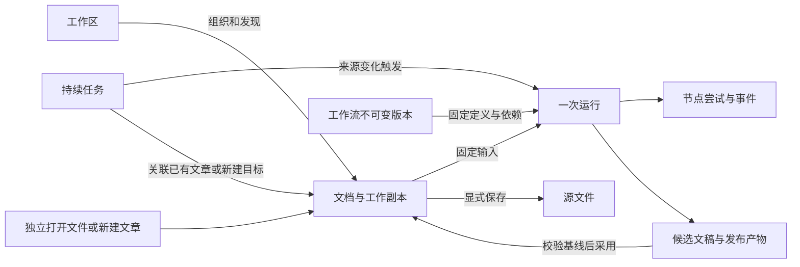
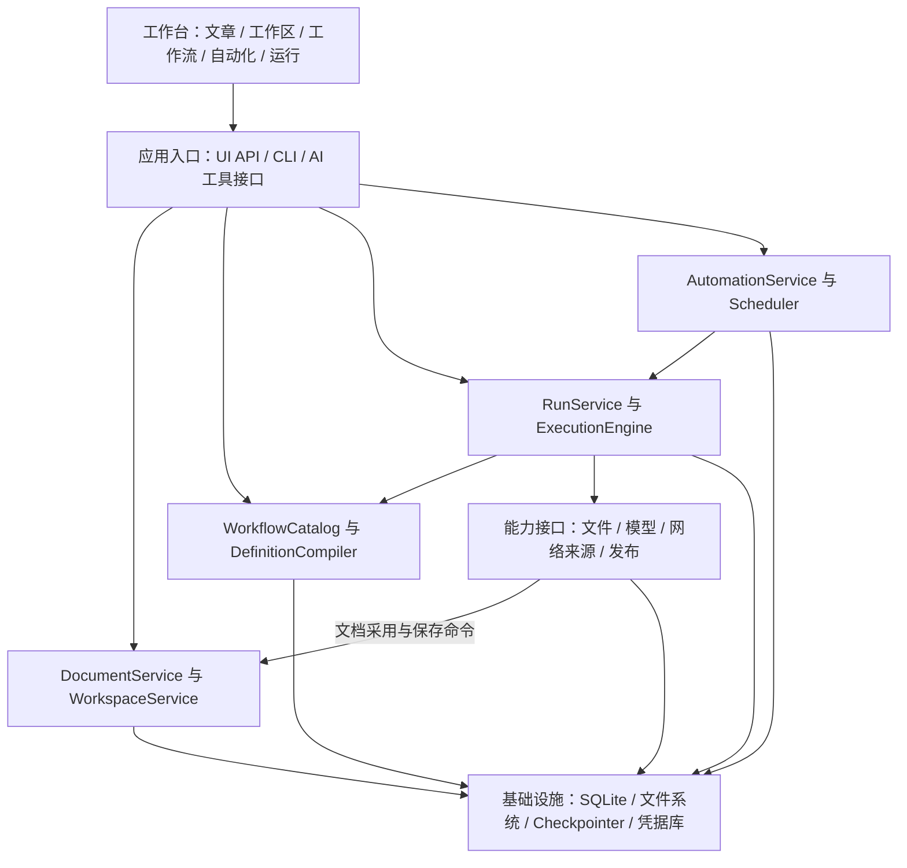
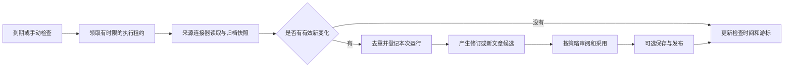

# 多场景工作入口与架构演进方案

日期：2026-11-13；P6 更新：2026-11-16。状态：**P1–P6 已实施**。P1–P6 实现与验证边界见下方实施状态，保留整体目标架构和后续阶段计划。

当前行为仍以[统一工作台规则](../workbench-and-workflows.md)及源码为准。除下方明确记录的 P1–P3 外，本文中的对象、模块、接口和验收项为拟议设计。继续使用现有技术栈和视觉体系。

## 1. 审视结论

“如何开始工作”不自然，根源在于几个生命周期不同的对象被绑定在一起：**打开文件必须先服从全局工作区，运行必须绑定当前文章，发布配置属于全局设置，工作流定义又依附在 Python 实现中。** 界面增加入口可以缓解表现，但只有拆开这些关系，才能同时支持临时编辑、目录写作、发布和持续维护。

建议产品定位为：**以文档为内容基础，以工作区组织文件，以工作流定义处理方法，以运行记录执行事实，以持续任务管理长期关注。** 这五者互相关联，各自拥有独立身份与生命周期。

### 1.1 P1 实施前的源码起点（历史依据）

| 优先级 | 已确认的实现 | 对用户场景的影响 | 源码依据 |
| --- | --- | --- | --- |
| 高 | 服务持有一个 `EditorService.root`；选择工作区外文件被拒绝；有活跃运行时不能换根目录 | 单文件入口实际要求先选择工作区；后台关注 A 项目时无法切去 B 项目 | [app.py](../../src/inkflow/web/app.py)：`lifespan`、`local_picker`、`switch_workspace` |
| 高 | 文章身份是工作区根目录与相对路径的组合，Web 新运行要求 `editor_source` | 同一文件从不同根目录打开可能有不同草稿身份；尚无文档的持续任务、生成任务难以接入 | [editor.py](../../src/inkflow/web/editor.py)：`identity`；[runs.py](../../src/inkflow/web/runs.py)：`create` |
| 高 | `OpenArticles` 仅组织已打开路径，文件发现接口返回全量文章路径列表 | “打开的标签页集合”和“工作区文件树”语义不同；缺少目录写作、新建文章和文章陈列入口 | [OpenArticles.tsx](../../frontend/src/OpenArticles.tsx)；[editor.py](../../src/inkflow/web/editor.py)：`files` |
| 高 | 仅有 `full-check`、`reviewed-publishing` 两个静态 Python 注册项；没有独立的仅脱敏流程 | 简单脱敏也进入包含生成与发布的业务链；增加流程仍要接 Python 工厂及专用协议 | [注册表](../../src/inkflow/workflows/__init__.py)；[处理图](../../src/inkflow/graphs/minimal.py) |
| 高 | 提示词在 Python 字符串中；全文检查提示词甚至位于节点函数内部 | UI 能看部分输入输出，却不能查看、编辑、比较实际使用的提示词版本 | [全文检查](../../src/inkflow/workflows/full_check.py)：`review`；[prompts](../../src/inkflow/prompts/article.py) |
| 高 | `blog/review/report` 是全局配置；发布只写 `<slug>/index.mdx` | 多站点、不同发布方式、不同文章模板没有独立配置归属；“发布完成”目前不等于网站部署完成 | [settings.py](../../src/inkflow/settings.py)：`SettingsData`；[publish.py](../../src/inkflow/services/publish.py) |
| 高 | 图使用 `InMemorySaver`；启动时 `recover` 将未完成运行标记中断 | 已有后台线程不等于持久任务系统；不能支持服务重启后继续关注和人工待办恢复 | [full_check.py](../../src/inkflow/workflows/full_check.py)；[minimal.py](../../src/inkflow/graphs/minimal.py)；[storage.py](../../src/inkflow/web/storage.py)：`recover` |
| 中 | `RunManager` 仍按工作流 ID、脱敏和建议类型分支；`NodeDetails` 按 `pending.kind` 渲染专用表单 | 通用注册表已有雏形，但业务细节仍穿透执行和展示层；新工作流并非即写即用 | [runs.py](../../src/inkflow/web/runs.py)；[NodeDetails.tsx](../../frontend/src/NodeDetails.tsx) |
| 中 | 已持久化事件和节点执行，但部分输入为空，错误主要为摘要，未固定提示词及执行器版本 | 能知道失败，却难以准确复现失败并评估 AI 修复；图描述快照不足以重放原逻辑 | [full_check.py](../../src/inkflow/workflows/full_check.py)：`tracked`；[runs.py](../../src/inkflow/web/runs.py)：`_custom`、`_drive` |
| 中 | `EditorWorkbench` 同时管理文档、工作区选择、运行桥接、布局和弹窗 | 扩展工作区首页、工作流设计和任务中心时，状态和导航容易互相牵制 | [EditorWorkbench.tsx](../../frontend/src/EditorWorkbench.tsx) |

上表是实施前的问题依据；其中独立文件、身份与文件组织已由 P1 处理，其余留待后续阶段。现有保护继续保留。现有源码编辑、草稿持久化、revision 校验、磁盘指纹、原子保存、候选对比、人工确认、事件游标和同文章运行互斥均有复用价值。

### 1.2 应保持的边界

- 源文件、工作副本、运行输入、候选稿和已确认版本继续分开；工作流产出候选，不直接取得编辑器内部状态。
- “保存文章”写入当前文件；“采用候选”修改工作副本；“保存流程”保存定义；“发布”执行配置好的输出步骤。四种动作分别反馈。
- 当前技术栈足够支持下一阶段，先做模块拆分，继续使用本地单用户、单服务和 SQLite；不提前引入微服务、消息中间件或更换编辑器。
- 不要求所有界面都以正文占据最大面积。文章编辑以正文为主，运行详情以节点进展为主，工作流设计以定义为主；共用同一份文档会话。

### 1.3 P1 实施状态

- `web/documents.py` 提供 DocumentService、WorkspaceService 与旧 WorkspaceEditor 适配；随机 document_id、精确文件范围、多工作区登记、完整树与元数据列表已接通。
- 未命名草稿、首次保存、另存为、位置查看／复制与独立保存状态已接通；新前端会话和运行以文档 ID 绑定，工作区浏览不修改服务端全局根目录。
- 新副本／版本表承接增量迁移，保留旧表、版本和运行关联；冲突旧草稿保留并提示，重复迁移不重置新稿。回退边界见 [WB-R10](../workbench-and-workflows.md#工作台规则)。
- P1 交付时复用 SourceEditor、DocumentDiff、useWorkflow 和两张内置图；当时没有加入提示词编辑、通用编排、持久运行恢复、自动化或 AI 修复。应用内移动和失联重新关联 UI 留待后续，当前提供失联提示与另存为。
- 自动化验收见 [tests/test_documents.py](../../tests/test_documents.py) 与基础回归；实际命令、浏览器结果和未验证项记录于根目录 implementation-notes.md。

### 1.4 P2 实施状态

- workflow_assets 以 SQLite 管理可编辑草稿、不可变提示词修订／流程包、CAS 与原子启用；运行绑定包，回退只影响新运行。内置 Python 图继续作为适配器，没有通用定义编译器。
- 全文检查、风险识别、按决定改写、文章生成／追问及兼容 MDX 草稿消息已冻结；限制变量替换，协议只读，基线测试覆盖原消息及花括号数据。
- 工作流入口、模型节点编辑、完整消息预览、显式试运行、版本差异／回退、节点尝试诊断已接通。仅脱敏复用现有审核／候选采用闭环，独立终点且无生成／发布节点。
- 审阅稿、博客和报告配置归属节点并随版本固定；全局配置作为迁移来源及显式导入的默认值。代码实现散列只供追溯，不提供旧代码重放。
- 迁移、使用、失败与权限边界见 [P2 当前行为](../workflow-assets.md)，测试见 [资产回归](../../tests/test_workflow_assets.py)。正式运行已由 P4 持久协议承接；测试重启仍中断，[P5 持续任务](../automations.md) 已实施，[P6 AI 编排与修复](../ai-orchestration.md) 已实施。

### 1.5 P3 实施状态

- 新增格式 2 定义／编译包、11 类注册能力及实例独立提示词／模型参数。顶层受限分支与输入支配校验，脱敏／追问保留有预算的注册循环；不执行任意代码。
- 工作流界面支持创建、复制、命名、节点与连线表单、输入绑定、配置、校验定位、计划预览、草稿保存、显式启用和历史回退。画布不决定执行顺序，窄屏与键盘使用同一表单。
- PublishProfile 固定修订，提供已有文章直接审阅并发布到本地目录的模板；不含模型节点时可关闭模型。审阅稿／报告／博客分别归属输出节点。
- 模拟与正式执行共用编译、绑定和分支语义，文件能力使用模拟适配器。运行中心复用原运行服务，按已登记资源查询。
- P2 包和内置图保留兼容，复制为 P3 时新建有来源的草稿；正式运行由 P4 恢复，已确认的输出不重写。未加入工作区默认值或运行参数覆盖。当前规则见 [P3 使用与边界](../workflow-definitions.md)，回归见 [P3 测试](../../tests/test_orchestration.py)。

## 2. 七类场景怎样开始

| 场景 | 用户入口与主要动作 | 首要信息 | 完成或持续的结果 |
| --- | --- | --- | --- |
| 临时处理一篇文章 | 打开文件 → 编辑 → 选择全文检查或仅脱敏 → 审阅 → 保存文件 | 文件名、完整位置、正文、未保存状态 | 写回所选文件，无须建立工作区 |
| 长期目录写作 | 打开工作区 → 浏览文件树或文章列表 → 新建／打开文章 | 目录结构、文章标题、修改时间、草稿和运行状态 | 文件持续保留在目录中；工作区记住布局和默认选择 |
| 发布一篇文章 | 在文章上选择发布流程，或从流程选择输入文章 | 发布目标、输出格式、当前节点、待办、执行结果 | 精确指出写了什么、部署到哪里、哪些步骤失败 |
| 持续维护文章 | 创建持续任务 → 选择来源、目标文章或新文章目录、检查频率、处理流程 | 最近检查、发现的变化、候选稿、下次检查、异常 | 每次变化产生有限的一次运行；原文更新和发布遵循任务策略 |
| AI 设计工作流 | 工作流页面输入意图 → AI 生成定义草稿 → 校验和试运行 → 启用版本 | 节点、变量、提示词、发布与关注方式、需要的能力 | 同一套定义供人工和 AI 编辑；不另建 AI 专用执行系统 |
| AI 协助修复 | 从失败节点打开诊断 → 生成修订 → 样例验证 → 启用并重新运行 | 错误上下文、原版本、修改差异、验证结果 | 新旧版本可追溯，必要时退回原启用版本 |
| 优化节点提示词 | 选中模型节点 → 编辑提示词 → 预览变量 → 试运行并比较 → 启用 | 模板、输出约束、实际消息、模型参数、历史版本 | 新运行使用新提示词，旧运行仍能查看原提示词 |

不在首页要求用户先理解七种模式。首页主操作是“打开文件”“打开工作区”“新建文章”，下面显示最近文件／工作区和少量待办。工作流与自动化通过常驻导航进入；“发布”和“全文检查”也能从文章上的工作流菜单直接启动。

## 3. 核心对象及不变量

### 3.1 对象模型

| 对象 | 职责与关键关联 | 生命周期 |
| --- | --- | --- |
| `Document` 文档 | 稳定 `document_id`；文件位置可为空；文件类型、编码和磁盘基线；可被多个工作区视图引用 | 新建或登记文件 → 编辑 → 保存；关闭视图不删除文档 |
| `WorkingCopy / DocumentVersion` | 当前文本与 revision、是否已写磁盘；不可变历史版本 | 草稿持续持久化，显式保存写文件，恢复产生新工作副本版本 |
| `Workspace` 工作区 | 稳定 ID、根目录、文件索引、默认工作流和列表偏好 | 登记／打开／关闭／移除登记；关闭不取消任务，不删除文件 |
| `WorkspaceDocument` | 工作区与文档的关联、相对展示路径 | 同一文件可从重叠工作区或独立入口到达，不复制草稿 |
| `WorkflowDefinition / WorkflowVersion` | 稳定流程 ID、可编辑草稿、不可变启用版本；节点、边、输入输出、提示词和配置依赖 | 编辑 → 校验 → 试运行 → 启用；归档不删除历史引用 |
| `PromptRevision` | 可复用提示词模板及变量声明；具体流程版本绑定具体修订 | 修改产生新修订，使用它的流程不会被静默批量升级 |
| `NodeTypeVersion` | 可执行节点类型、输入输出 schema、配置 schema、交互种类、能力与重试约束 | 内置或安装后注册；工作流固定可用版本 |
| `Run / NodeAttempt` | 一次执行及节点尝试；绑定流程包、输入快照、来源、事件和结果 | 排队 → 运行／等待 → 完成／失败／停止；独立于界面选中项 |
| `Artifact / DocumentProposal` | 文稿、变更建议、来源快照、报告、发布回执；候选带目标与基线 revision | 产生 → 审阅／采用／拒绝／失效，保留来源链 |
| `Automation` 持续任务 | 来源、触发计划、目标绑定、流程版本策略、启停和更新策略 | 启用 → 多次检查和运行；可暂停、失败退避、恢复或归档 |
| `Connection / PublishProfile` | 前者提供连接和凭据引用，后者描述某种输出目标及方式 | 可复用、可版本化的非密钥配置；具体流程节点选择使用 |



### 3.2 文档与路径规则

- **ARCH-R01 独立文档**：打开单个文件登记精确文件位置，不自动把父目录注册成工作区，也不顺带获得同目录其它文件的访问范围。工作区入口登记目录范围。服务按已登记资源校验每次读取与写入。
- **ARCH-R02 同文件同身份**：服务在同一宿主文件系统内规范化路径后分配／复用 `document_id`，而不是使用“当前工作区 + 相对路径”作为文档主键。保留符号链接限制，遵循宿主的大小写规则；不凭文本相同或猜测 Windows／WSL 路径来合并文件。
- **ARCH-R03 移动与新建**：应用内移动更新路径映射并保留 ID；外部移动先标记原位置失联，再由用户重新关联，不按内容 hash 自动合并。新建未命名文章先有 ID 和持久草稿，首次保存选择目标；“另存为”创建新文件文档并建立来源关系。
- **ARCH-R04 保存语义**：自动保存只承诺“草稿已保留”；只有文件写入成功才显示“已保存到文件”。磁盘冲突不能被草稿状态掩盖。采用工作流结果和恢复版本仍需显式保存原文件。
- **ARCH-R05 UI 上下文**：浏览工作区和切换文章只改变当前视图；不能改变运行所属的资源、取消任务或使其它标签页的文件引用重新指向另一根目录。

### 3.3 运行与写入规则

- **ARCH-R06 绑定输入而非当前页面**：输入契约支持文档快照、来源快照或生成任务参数；不是每个运行都必须已有目标文章。运行携带明确的目标文档／输出目录及能力范围，不能向空 `editor_source` 填假文章来兼容。
- **ARCH-R07 版本固定**：运行固定工作流、提示词、节点实现、连接非密钥配置及模型参数的版本。凭据只按受控引用在执行时解析，不把密钥写入版本包；凭据轮换应有记录，失效时返回可恢复错误。
- **ARCH-R08 并发**：初期保留同文档一个活跃交互运行，以 `document_id` 替代原组合键。持续关注本身不占这个名额；目标被占用时去重排队。后续若开放多个只读检查，候选采用仍须 revision 校验，文件输出仍须按目标路径串行核验，不能直接删除现有互斥。
- **ARCH-R09 副作用分离**：文档更新、文件输出、远程发布分别有产物和回执。发布工作流明确选择“当前稿快照”还是“已保存文件版本”，默认使用当前稿快照并标明未保存来源；发布成功不替用户执行源文件保存。

## 4. 模块怎样分层



这是同一应用中的依赖边界，不是立即拆成多个部署服务。

| 拟议边界 | 负责 | 不承担 | 现有实现的迁移来源 |
| --- | --- | --- | --- |
| `documents/` | 文件登记、工作副本、版本、候选采用、保存和冲突 | 模型调用、流程跳转、发布策略 | `web/editor.py`、`services/local_files.py` |
| `workspaces/` | 多工作区登记、目录发现与索引、列表和新建文件位置 | 全局运行上下文、文档主键 | `app.py` 工作区路由、`EditorService.files` |
| `workflow_assets/` | 定义、提示词、版本包、校验、编译、启用与回退 | 调度和当前运行状态 | `workflows/__init__.py`、`prompts/` |
| `execution/` | 运行、节点尝试、待办、事件、恢复、停止、重试与效果记录 | 按某个流程 ID 实现文章业务 | `web/runs.py`、`runtime.py`、`actions.py` |
| `nodes/` 与 `connectors/` | 检查、脱敏、生成、人工审阅、文件输出、来源读取等能力 | 自行改变当前文章、绕过服务写源文件 | `graphs/minimal.py` 的业务节点、`services/` |
| `automation/` | 调度、游标、来源去重、运行关联、积压与退避 | 无限循环跑整张处理图 | 新模块，复用运行服务 |
| `infrastructure/` | 存储事务、检查点适配、凭据、文件访问和网络传输 | UI 当前页和业务模式判断 | `web/storage.py`、`settings.py` 等基础实现 |

前端相应拆为 `WorkbenchShell`、`DocumentSessionStore`、`WorkspaceExplorer`、`ArticleCollection`、`WorkflowStudio`、`RunInspector`、`AutomationCenter`。名称用于交接，不要求先批量移动文件。先提取状态和服务接口，再逐步迁移组件。

`DocumentSessionStore` 按文档 ID 保存正文会话、撤销栈、光标和视图偏好；文章页、运行页跳转回同一会话。`RunInspector` 使用运行 ID，不读取“当前工作区”的可变全局值。现有 `SourceEditor`、`DocumentDiff`、`WorkflowCanvas` 和主题继续复用。

## 5. 工作流、节点与提示词

### 5.1 先建立定义资产，再扩展可视化编排

将“实际执行的定义”和“用于展示的图”统一到同一份版本化描述。现有两张图先通过适配器进入目录；复杂退回和追问逻辑可以继续由内置子流程执行，避免一次性重写全部审核行为。

工作流定义至少包含：稳定 ID、schema 版本、名称、输入／输出契约、节点实例、边与分支、参数、提示词修订、连接引用、人工确认点、重试和超时限制。画布坐标作为展示字段，不能决定执行顺序。

节点实例引用稳定节点类型和版本。节点类型公开输入输出 schema、可配置字段、是否有模型提示词、支持的人工交互、是否产生外部效果、幂等／重试能力。简单待办由 schema 驱动；差异审阅与文章建议继续复用专用渲染器，通过交互类型注册，避免每增加工作流都修改 `NodeDetails` 的顶层条件。

校验包括缺失节点／变量、字段类型、不可达节点、分支出口、缺少终点、缺失连接、能力不匹配、循环预算与输出格式。现有工作流存在退回循环，不能简单以“必须为 DAG”抹掉业务；循环只通过声明的控制结构或内置子流程表达，并规定最大次数与结束条件。分支使用受限条件结构，不执行配置中的任意代码。

建议的首批组合：

| 工作流 | 可复用步骤 | 结束效果 |
| --- | --- | --- |
| 全文检查 | 文本快照 → 检查 → 建议定位 → 人工处理 | 更新工作副本，用户保存文件 |
| 仅脱敏 | 文本快照 → 风险检查 → 审阅 → 改写 → 差异确认 → 复查 | 不进入文章生成和发布；复用原脱敏子流程 |
| 发布已有文章 | 输入文章 → 可选检查／脱敏 → 元数据与格式处理 → 最终确认 → 输出／部署 | 发布回执；无需强制重新生成文章 |
| 从素材生成文章 | 素材 → 生成与追问 → 审阅 → 可选发布子流程 | 新文档或指定目标候选稿 |
| 持续更新 | 来源快照与变化 → 判断相关性 → 修订建议／新文章 → 审阅 → 可选发布 | 由持续任务逐次触发，单次运行有限结束 |

### 5.2 提示词编辑闭环

**ARCH-R10 提示词是用户可见的流程资产。** 模型节点提供以下页签；非模型节点不显示无意义的提示词编辑器。

| 页签 | 用户可以看到和操作的内容 |
| --- | --- |
| 配置 | 节点名称、模型选择、参数、超时、输入绑定及输出格式 |
| 提示词 | system／user 模板、变量声明、默认值、未定义变量提示、模板修订历史与差异 |
| 输入／输出 | 本次固定输入、实际渲染 messages、模型输出、解析后的结果与 schema 错误；大内容按需展开 |
| 执行记录 | 每次尝试、耗时、错误、重试来源、版本；供应商提供时显示 token 使用量 |

编辑流程为：从已启用版本创建草稿 → 修改 → 本地变量与格式校验 → 用固定样例预览完整 messages → 可选调用模型试运行 → 对比结果 → 保存并启用新版本。预览模板不调用模型；试运行明确显示将发送的内容，不执行真实写文件或发布步骤。

输出 schema 和必要的运行协议是可见的节点契约；普通提示词编辑不隐式改变解析器。用户删除格式说明或引用未知变量时，校验应解释问题。模板采用受限变量替换，不把文章中的花括号再次作为模板执行。

历史运行的提示词只读；在历史页点击“编辑提示词”会创建流程草稿。复用提示词的新修订应列出受影响流程，由各流程显式采用，不能因共享引用而改变已经启用的定义。

### 5.3 发布设置归属

应用设置保留模型连接、凭据、本机数据位置等基础设施。**发布目录、格式、命名方式、是否部署和何时等待确认，放到工作流的输出节点中。** `PublishProfile` 作为可复用配置，在节点内选择和编辑；并非强迫用户到全局设置寻找发布方法。

工作区可指定默认流程及发布配置；运行启动时显示最终解析后的目标，并固定快照。一般参数优先级为“节点默认值 → 工作流配置 → 工作区明确覆盖 → 本次运行参数”，只允许覆盖声明的参数。文件范围、网络能力和确认策略不能被低层覆盖扩大。

先把当前博客文件写入包装成 `local-blog` 输出能力，保持路径和指纹保护。Git、构建、部署、CMS 上传等后续成为独立节点或连接器；各自有明确结果，例如“文件已写入”“构建成功”“部署成功”。一个节点成功不能代替整条发布链成功。

## P4 实施状态

P4 已增量接入 RunManager、SQLite 与现有图，具备持久检查点、待执行记录、租约、原人工待办恢复、模型未知结果阻止重发、文件效果记录与核验。实际事务边界、兼容／迁移及剩余故障窗口见 [P4 当前规则](../durable-execution.md)，故障注入见 [恢复测试](../../tests/test_recovery.py)。P5 已实现来源检查、事务积压、待审候选与自动化中心，实际边界见 [P5 当前规则](../automations.md)。P6 已复用资产和诊断实现 AI 提案、验证门禁及关联修复运行，实际边界见 [P6 当前规则](../ai-orchestration.md)；下文保留目标架构，隔离 worker、文件监听及可信目录自动启用仍未提供。

## 6. 持续任务、互联网与执行恢复

P5 已按下述方向实施；首版为明确文件轮询、固定间隔、未命名新文与人工采用，自动保存/发布和 cron 尚不提供。详见 [P5 当前行为及验收](../automations.md)。

### 6.1 持续任务不是永久运行的工作流

**ARCH-R11 持续任务负责何时再次检查，工作流负责本次如何处理。** `Automation` 保存来源、游标、检查频率、下次执行时间、目标文档或新建目录、流程固定版本、变化去重键和更新策略。



来源读取先实现明确目标的 HTTP／RSS／项目变更连接器，再考虑搜索服务。每份快照记录来源 URL、获取时间、版本或 ETag、内容摘要和引用，供文章修订与事实核验。模型接口能联网不代表系统已经具备这些来源能力。

连接器负责超时、限流、失败退避、最大响应体与重定向检查；凭据通过连接引用提供。互联网读取与本机／内网连接分开配置，不能因来源重定向扩大访问范围。外部内容作为资料，不获得修改流程、读取密钥或发布文章的权限。

默认变化仅产生待审候选；允许用户以后在具体持续任务中启用“自动采用并保存”或“自动发布”，明确目标、适用条件与失败处理。执行前始终重验文章 revision、磁盘基线和发布目标；人工修改期间检测到冲突，转入待办而不是覆盖。

去重、游标推进和运行创建需事务协调：只有变化已持久化为待处理项或运行后才推进游标，避免崩溃漏掉变化。同一来源变化和目标不重复创建运行。积压期间可以合并变化范围，但保留每次来源证据；自身生成的文件事件带来源标记，防止更新触发自身的无限循环。

默认按固定流程版本运行；提供“采用最新已启用版本”的显式策略，每次触发记录实际版本，不能读取未经校验的草稿。暂停任务停止新触发，当前运行是否停止单独处理。

### 6.2 持久运行的最低要求

- 运行服务采用持久队列、节点状态、人工待办和可恢复检查点；不能仅把线程池换成定时线程。关闭浏览器继续执行，关闭后台服务期间无法联网工作，重启后按补跑策略恢复。
- 先保留单服务和 SQLite 的部署方式；执行器与 UI 状态解耦。是否进一步拆独立 worker，由故障隔离和运行时热更新需求决定。
- 人工待办持久化输入及动作 schema，重启后继续核验 `pending_id`、动作幂等和版本。旧的内存检查点运行仍标记中断，不能伪造恢复。
- 事件、运行状态、节点结果、调度游标之间明确事务边界；恢复检查点和业务结果不一致时先对账，不直接向下推进。持久化适配器选择与依赖可用性在实施阶段验证，不能假设当前安装版本已提供可直接使用的 SQLite 检查点包。
- 模型调用允许有界重试；发布、文件写入等必须记录效果键、目标和回执。远程请求超时且结果未知时先查询外部状态；无法查明则进入人工核验，不盲目重试。不要宣称端到端“恰好一次”。
- 对休眠／离线错过的计划，默认恢复时合并检查一次，不补发每一个错过的时间点；检查间隔、时区和补跑策略可查看。持久任务的“等待人工”“重试等待”“暂停”与“正在执行”分别展示。

## 7. 热更新与 AI 修复

P6 当前实现：AI 通过已有服务创建独立身份的声明式草稿，固定失败版本／尝试／输入引用；模型建议经过能力检查、差异审阅、CAS 采用、固定样例与模拟后显式启用。普通启用 API 也核对对应验证结果；新运行记录 repair_of，成功文件或未知效果阻止关联重跑。新增 ai_proposals 表，生成请求重启不重发，验证中断不算通过。源码修改仍使用受控重启与原指纹保护；不加载任意 worker 或脚本。

### 7.1 分层热更新

**ARCH-R12 修改变成新版本，运行绑定版本，启用通过原子切换完成。** “保存后可用”不要求正在执行的对象被原地替换。

| 修改对象 | 生效方式 | 对已有运行的影响 |
| --- | --- | --- |
| 提示词、节点参数、流程图、发布配置 | 校验并创建完整不可变版本包，原子切换启用指针 | 原运行继续旧包；新运行使用新包 |
| 基于已安装节点类型的新流程 | 保存、校验、启用后立即出现在流程列表，可启动 | 无需重启应用；“即写即用”的首要范围 |
| 新增或修改节点执行代码 | 注册版本化执行单元；后期在隔离 worker 中加载新版本并检查健康状态 | 原 worker 完成绑定旧版本的运行后退出；不在同一进程随意 `importlib.reload` |
| React 业务界面 | 开发环境由 Vite HMR 辅助，正式版本更新前持久化会话再刷新 | HMR 不充当业务运行恢复机制 |
| 核心引擎、数据库 schema、运行协议 | 兼容性检查、迁移与受控重启 | 从可靠检查点恢复；不兼容运行明确中断或保留旧执行器 |

后续若增加文件形式的资产导入，可考虑应用数据目录的 `workflows/<id>/`，以 `workflow.json` 和 Markdown 提示词文件支持人工／AI 编辑；这是未来设计路径，本轮不创建。P2 的草稿、不可变版本包及引用均保存在 SQLite；未来文件只作为导入草稿来源，不直接改变运行配置。

UI 与 AI 通过同一个资产服务写草稿，携带内容版本避免互相覆盖。文件监听只负责触发重新读取和校验：部分写入、非法 JSON、缺失变量和类型不匹配保留诊断，不替换最近可用版本。默认文件变更形成候选版本；用户可为可信资产目录启用“校验成功自动启用”。多文件包需完整一致后才能切换，不能在提示词与图各写一半时启动。

旧版本在仍被运行／历史引用时保留；回退改变后续运行选择，不撤销已发布文章。任意新 Python 逻辑不属于声明式工作流，必须走节点实现的加载和验证路径。

### 7.2 可诊断、可复现、可验证的修复闭环

**ARCH-R13 修复入口基于结构化诊断，复用正常版本流程。** 每次节点尝试至少记录：`run_id`、节点及尝试 ID、输入产物引用、定义／提示词／执行器版本、实际模型参数、经脱密的消息、输出或解析失败信息、错误分类、可重试性和外部效果状态。

对于代码异常，补充经过凭据过滤的异常类型、原因链和堆栈；对于模型输出不合约，保留受限的原始响应及字段错误；对于连接失败，保留状态码和连接标识。敏感正文按私有产物存储并控制读取，常规摘要不复制整篇正文或访问令牌。当前只替换一个模型密钥的 scrub 不能直接充当未来所有连接器的脱密机制。

修复过程：读取失败诊断与相关定义 → 分类为提示词／配置／连接／代码问题 → 生成差异草稿 → 静态校验与固定样例回归 → 无副作用试运行 → 启用 → 创建带 `repair_of` 的新运行或节点重试记录。

修改过定义的修复属于新运行版本；可以显式复用输入与上游产物，但必须校验依赖摘要和外部效果记录，不改写旧运行历史，也不自动重放已经成功的发布节点。模型行为有随机性，固定输入和参数提供可比较条件，不保证逐字复现。

AI 获得与人相同的受限命令：读定义／诊断、写草稿、校验、测试、提出启用变更。已有明确授权的配置修改可自动完成；新增发布目标、凭据能力或可执行代码按其实际权限处理。不能把“允许调整提示词”解释为允许任意脚本执行或自动对外发布。

## 8. UI 组织：保留风格，重排信息

### 8.1 导航与工作区域

沿用 `theme.ts` 的浅灰背景、白色正文、轻边界、字体、MUI 控件及现有状态色。新布局提供“文章／工作流／自动化／运行”四个文字入口，复用现有顶栏和侧栏组织导航，不额外叠加装饰性导航栏。

```text
InkFlow       文章 / 工作流 / 自动化 / 运行               设置
┌────────────────┬───────────────────────────────────────┐
│ 最近与工作区    │ 当前页面标题、路径或版本、主要操作     │
│ 已打开文章      ├───────────────────────┬───────────────┤
│ 工作区完整树    │ 编辑器 / 文章列表 /   │ 上下文详情    │
│                │ 工作流画布 / 运行图   │ 建议、节点、  │
│                │                       │ 待办与诊断    │
└────────────────┴───────────────────────┴───────────────┘
```

这是结构线框；具体页面只出现相关的导航和面板，不要求同时显示所有内容。

| 页面／视图 | 中央内容与主要操作 | 上下文区 |
| --- | --- | --- |
| 开始／最近 | 打开文件、打开工作区、新建文章；最近项目 | 需要注意的待办与失败摘要 |
| 文章编辑 | 文件名、可查看／复制的完整路径、编辑／预览、历史、保存文件 | 检查建议、当前运行摘要；点击可进入完整运行 |
| 工作区首页 | 默认文章列表；可选卡片视图；新建文章、搜索、目录过滤和排序 | 文章信息或预览，不自动启动 AI |
| 工作流 | 定义列表、用途和版本；进入后为图与参数 | 节点配置、提示词、样例测试、版本差异 |
| 自动化 | 持续任务列表、启停、最近／下次检查、来源变化、积压 | 来源设置、目标、候选与异常 |
| 运行 | 跨工作区运行列表，按状态／文档／任务过滤；详情为节点进度 | 实际输入输出、错误、人工待办、发布回执 |

运行中心与文章侧栏是同一运行的不同视图。关闭文章或进入工作流设计，不卸载／销毁文档会话；返回后恢复编辑位置。列表中的待办直接定位对应节点与文章。

### 8.2 文件树、文章陈列和保存感知

- “已打开”是可关闭的会话集合；“工作区文件”展示完整可见目录和尚未打开的文章，二者明确分组。目录可按需加载，搜索与排序不改变真实磁盘结构。
- 文章列表默认展示文件名／标题、相对位置、最近修改、未写回标记和运行状态；卡片视图增加摘要，属于可选阅读入口。标题和摘要从已有正文／元数据提取，不为列目录自动调用模型；解析失败回退到文件名。
- 未保存文章以当前工作副本信息为准，磁盘索引更新不能覆盖正在编辑的稿件。索引是可重建缓存，文件和工作副本才是正文事实。
- 文件头显示路径，保存按钮固定可见；状态分别为“草稿保存中”“草稿已保留 · 未写回文件”“保存文件中”“已保存到文件”“保存失败／外部冲突”。检查运行状态放在独立位置，不再占用保存状态文字。
- 新建文章支持先写后选位置，也支持在工作区目录下创建；重名、只读、目录失联和首次保存失败都有明确反馈。
- 简单检查默认只展开建议；执行发布时可展开节点进度；设计流程时明确显示“定义草稿／已启用版本”，回看执行时显示“运行快照”，避免编辑错对象。

### 8.3 响应式与交互验收

复用当前窄屏 Drawer、可收起面板和键盘分隔条。窄屏工作流与自动化使用列表和详情切换，保证保存、待办和失败操作可到达，不把所有桌面面板垂直堆满首屏。文件树具备展开键盘操作，提示词表单有明确标签，状态同时提供文字，长路径可查看完整值。

后续实施需实际检查空态、加载、连接断开、过期结果、非法模板、外部修改、后台积压及小屏显示。本轮只提供结构方案，未制作新 UI 或进行浏览器视觉验收。

## 9. 接口与数据迁移方向

以下是职责级接口草案，路径命名在实施时统一；不是现有接口文档。

| 入口 | 关键请求／返回 | 对应规则 |
| --- | --- | --- |
| 登记与打开文档 | 经本机选择／登记的文件引用 → `document_id`、位置、工作副本、revision 与保存状态 | ARCH-R01～04 |
| 工作区登记与浏览 | `workspace_id`、目录游标、查询 → 文件条目与文档引用 | ARCH-R02、05 |
| 文档修改与保存 | `document_id`、基线 revision、文本或候选引用 → 新 revision／冲突 | ARCH-R04、08 |
| 工作流草稿／版本／校验／启用 | 定义及草稿版本 → 诊断或不可变版本 ID；校验失败不改变启用指针 | ARCH-R07、10、12 |
| 创建／读取／推进运行 | 明确流程版本、输入与目标引用、幂等键 → Run、待办、事件游标和产物 | ARCH-R06～09 |
| 持续任务管理 | 来源、目标、计划、流程版本策略 → 状态、下次检查、检查与运行历史 | ARCH-R11 |
| 节点诊断与测试 | 尝试 ID 或定义草稿＋样例 → 可比较结果、错误和版本来源 | ARCH-R10、13 |

迁移采用增量 schema 和兼容适配，先加稳定 ID 与映射，后移除“当前全局根目录”依赖：

1. 为旧工作区、文章组合键建立映射，保留旧 payload 和版本 ID。发现多个旧键指向同一文件时，草稿相同才自动归并；不同草稿保留为冲突分支并明确选择，不丢失历史。迁移可重复执行。
2. 新 API 使用显式资源 ID；旧接口仍经原上下文校验后转译，不能简单删除 `X-InkFlow-Workspace` 保护。SSE 和产物读取按运行已登记的资源范围校验；全局运行中心是本机用户明确查询多个已登记工作区的视图，不是放开任意路径读取。
3. 把现有注册项包装为内置流程版本，把当前提示词冻结为初始修订；旧运行缺少完整模板快照时标记“旧版，提示词版本未知”，不能套用当前提示词冒充历史。
4. 把旧博客设置转换为默认输出配置供新流程引用，保留原配置文件兼容读取。CLI 仍支持既有参数，并逐步走同一文档／流程服务。
5. 持久执行就绪前沿用重启中断语义；启用新恢复协议时给运行记录协议版本。停止旧运行或让其完成后再迁移活动执行，不能猜测内存检查点。
6. 每阶段保留迁移前备份和兼容读取窗口；回退代码前检查新增数据能否被旧版本理解。回退启用版本不等于回退数据库，也不删除用户在新版本写入的文章。

## 10. 分阶段改造计划与退出条件

顺序为 **P1 → P2 → P3 → P4 → P5 → P6**。提示词编辑在 P2 交付，早于完整流程设计器；后台持续任务在持久恢复具备之后交付。每阶段都是可独立验收的产品变化。

| 阶段 | 交付范围和涉及模块 | 可以验收的完整场景 | 进入下一阶段前必须成立 |
| --- | --- | --- | --- |
| P1 文档与工作区解耦 | 资源登记和稳定文档 ID；多工作区上下文；提取文档会话；独立打开、新建、完整树、文章列表、保存状态；迁移 `EditorService` 与工作区路由 | 打开工作区外文件，编辑并保存；打开工作区浏览未打开的文章；A 文章运行时浏览 B 工作区再返回 | 同文件只出现一个工作副本；草稿、撤销、历史与冲突保护不退化；运行不依赖选中工作区 |
| P2 流程资产、提示词与诊断 | 为内置流程建立版本包；提取所有模型提示词；新增节点提示词编辑、变量预览、固定样例试运行和结构化错误；输出配置移入流程节点；提供仅脱敏流程 | 修改全文检查提示词并启用，新运行使用新版本；旧运行仍可看原提示词；仅脱敏后保存源文件 | 模板、节点实现与非密钥配置绑定明确；非法版本不生效；样例测试不写用户文章或发布 |
| P3 定义驱动编排与发布 | 节点类型注册、编译和交互渲染契约；工作流设计界面；组合检查／审阅／输出；将专用条件逐步移出 `RunManager`、`NodeDetails` | 用现有节点创建发布已有文章流程，配置不同目录，无须改应用源码即可启动；运行中心查看真实进展 | 展示图与执行图一致；分支与循环受限；源文件保存与发布互不混淆；原处理流程回归通过 |
| P4 持久执行与恢复 | 持久队列、检查点、待办、租约、效果记录和恢复对账；保留单机部署 | 浏览器关闭继续运行；服务重启后继续人工待办；写入后崩溃不重复执行已确认效果 | 故障注入覆盖执行边界；结果未知的发布进入核验；旧运行兼容；核心升级有恢复与中断规则 |
| P5 持续关注与来源连接 | 自动化中心、计划与来源游标、HTTP／RSS／项目变化适配、去重与退避、候选更新、可选复用发布 | 持续关注一个来源并维护旧文，或按变化生成新文；无变化不生成；冲突转待办 | 来源证据可追溯；断网、休眠、重复触发与自身写入不会丢任务或无限重跑；任务启停可见 |
| P6 AI 编排与修复 | 复用资产与诊断 API；AI 生成流程／提示词／配置草稿，样例评估、修复差异和回退；按需引入版本化节点 worker | AI 根据需求生成可验证流程；读取一次失败并提出可验证修订，启用后创建关联修复运行 | AI 使用同一契约；不扩大能力范围；旧运行可解释；代码节点更新与配置更新有不同验证路径 |

P1 已补迁移与行为契约用例并增量提取服务；P2 先把现有提示词原样迁入版本资产，确认行为基线后再允许优化。这些是阶段内步骤，不另起大规模框架重写。

### 10.1 关键验收矩阵

| 范围 | 必须覆盖的反例或失败路径 |
| --- | --- |
| 文件与工作区 | 外部文件、重叠目录、同名文件、外部移动、未命名文章、取消选择、权限失败、多标签页旧请求；切换视图不导致串写 |
| 保存与候选 | 自动保留草稿后仍显示未写回；磁盘被外部修改；候选生成后继续编辑；版本恢复只改工作副本；BOM／换行／MDX 保持 |
| 提示词与定义 | 未定义变量、非法 JSON、schema 不匹配、无界循环、写入一半；提示词启用前后各启动一次运行，核验绑定版本 |
| UI 会话 | 编辑后进入运行／设计页再返回；光标、滚动、撤销、未保存文本保留；键盘、窄屏、长路径与错误状态可操作 |
| 发布与恢复 | 覆盖前目标变化、输出后回执落库前崩溃、远程超时但实际成功、重复动作、停止与完成竞争、待办重启后继续 |
| 自动化 | 来源无变化、同事件重复到达、人工待办期间再次触发、离线与休眠恢复、游标事务中断、来源重定向、自身输出触发事件 |
| AI 修复 | 读取正确版本和脱密诊断；错误修订不启用；新版本失败可回退；修复不再次发布已成功产物 |

实施时延续[现有回归测试](../../tests/test_regressions.py)，特别保留 CLI、工作区隔离、SSE 和文件权限用例，并为上述数据一致性与恢复路径添加必要测试。现有测试不能作为尚未实现能力已经通过的依据。

## 11. 初始架构设计阶段交付记录（历史）

- 已静态审阅文章身份、工作区选择、注册图、提示词、运行管理、存储恢复、发布配置及前端组织；方案基于这些源码事实。
- 本轮只新增设计及文档导航，维护根目录 `implementation-notes.md`；不改业务代码、依赖、配置、数据库或用户文件。
- 不新增 backlog：本文阶段计划已经承载本次明确提出的演进范围。
- 收尾检查通过：三份变更文档的 44 个本地链接目标存在，空白和代码块配对检查通过，Git 差异空白检查通过。未运行应用测试、模型调用、浏览器验证或 Mermaid 渲染，不能据此宣称目标架构已可运行。
- P1 已同步 README、当前规则、架构地图和文档索引；后续阶段落地时继续同步。

P3 后续实施与验收以 [定义与发布当前行为](../workflow-definitions.md) 和根目录 implementation-notes.md 为准。文章确认现按客户端文档身份、revision、正文基线执行锁内校验；展示节点顺序与编译连接顺序一致，画布位置不参与执行。上述设计阶段“未运行”记录不代表后续实施的验证状态。
